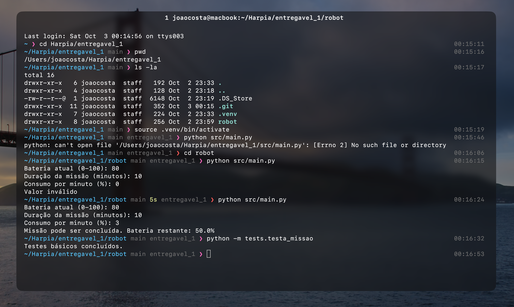

# Entregáveis do processo seletivo da Minerva Harpia

*feito por João Pedro de S. T. Costa*

Cada entregável fica em sua própria pasta, com código, README e instruções de execução:

```
entregavel-harpia/
├── entregavel-1/   verificação de bateria do robô
└── entregavel-2/   visualizador de imagens anotadas com OpenCV
```

Pensado apenas para Linux ou macOS e testado somente no macOS. Os ambientes virtuais são criados com UV, dentro da pasta de cada entregável.

---
## Entregável 1: verificar bateria do robô
Lê a bateria atual, a duração da missão e o consumo por minuto, e informa se a missão pode ser concluída. Detalhes em [entregavel-1/README.md](entregavel-1/README.md).
```
cd entregavel-1
python src/main.py
```



---
## Entregável 2: visualizador de imagens anotadas
Lê as bounding boxes de `dados/anotacoes.csv`, desenha as caixas nas dez imagens do material complementar e mostra uma imagem por vez (`Espaço` avança, `q` encerra). Detalhes em [entregavel-2/README.md](entregavel-2/README.md).
```
cd entregavel-2
uv venv .venv
source .venv/bin/activate
uv pip install -r requirements.txt
python src/main.py
```


