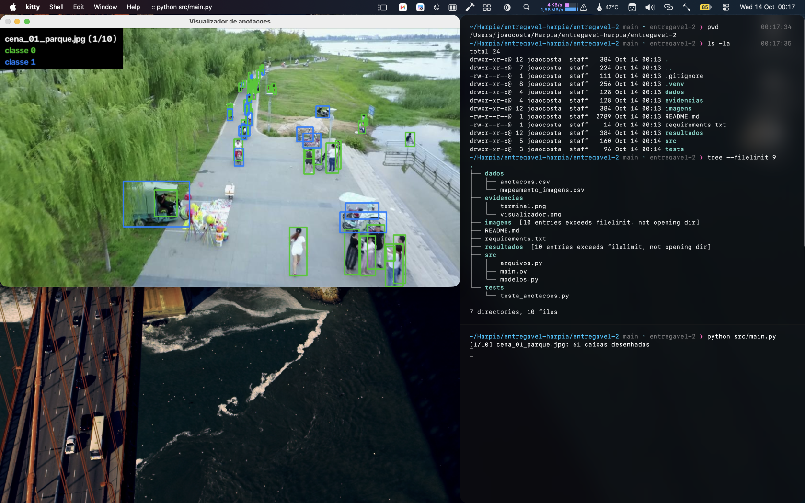
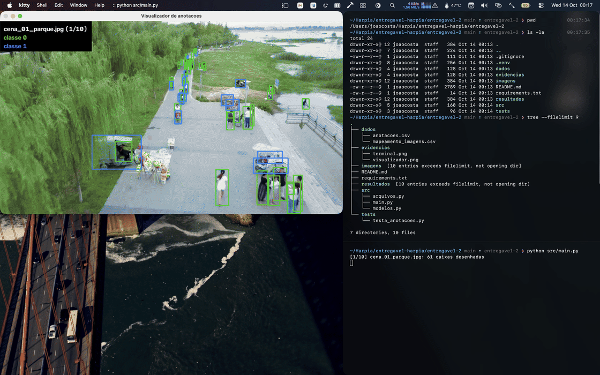

# Entregável 2 do processo seletivo da Minerva Harpia
## Visualizador de imagens anotadas com OpenCV
**Objetivo:**
ler as bounding boxes de `dados/anotacoes.csv`, transformar cada linha em um objeto e desenhar as caixas sobre as dez imagens do material complementar, exibindo uma imagem por vez em uma janela do OpenCV. Cada imagem anotada é salva em `resultados/` com o mesmo nome e a resolução original.

*feito por João Pedro de S. T. Costa, 13/10/2026*

---
**Requisitos:**
- Python 3.10+
- `opencv-python` (listado em `requirements.txt`; o `numpy` vem junto como dependência)
- Ambiente virtual com UV
```
uv venv .venv
source .venv/bin/activate  # Linux/macOS
uv pip install -r requirements.txt
```

Observação: pensado apenas para Linux ou macOS e testado somente no macOS. É preciso um ambiente com suporte a janelas gráficas.

**Comando de execução**
A partir da pasta `entregavel-2/`, execute com:
```
python src/main.py
```
O terminal mostra o nome de cada imagem e a quantidade de caixas desenhadas. Uma execução completa gera as dez imagens em `resultados/`; os arquivos de `imagens/` não são alterados.

**Controles do visualizador:**
- `Espaço`: avança para a próxima imagem.
- `q`: encerra o programa depois da imagem atual.
- Qualquer outra tecla mantém a imagem atual.

Ao passar da última imagem, a janela é fechada. Se o CSV ou alguma imagem não puder ser lido, ou se uma linha tiver campos inválidos ou caixas fora dos limites da imagem, o programa mostra a mensagem de erro e encerra.

**Organização do código:**
- `src/main.py`: função `main()`, que coordena a leitura dos dados e o loop de visualização.
- `src/modelos.py`: classes `Deteccao` e `ImagemAnotada`.
- `src/arquivos.py`: leitura do CSV com a biblioteca `csv`, agrupamento das caixas por imagem e abertura das imagens.

**Classes:**
- `Deteccao`: guarda `classe_id`, `x_min`, `y_min`, `x_max` e `y_max` (cantos inclusivos, em pixels). O método `desenhar` recebe uma imagem e desenha a própria caixa com `cv2.rectangle`, usando verde para a classe 0 e azul para a classe 1.
- `ImagemAnotada`: guarda o caminho da imagem e a lista de objetos `Deteccao`. O método `adicionar` inclui uma nova detecção e `desenhar_caixas` devolve uma cópia da imagem com todas as caixas, chamando `desenhar` de cada detecção.

A legenda com o nome da imagem e as cores de cada classe é desenhada apenas na cópia exibida na janela, depois de reduzida para caber na tela; as imagens salvas mantêm só as caixas.

**Testes:**
Obs.: você pode usar ```python -m tests.testa_anotacoes``` para verificar o funcionamento das classes e da leitura do CSV.

**Exemplo de execução:**
Os recortes do terminal e da janela ficam em `evidencias/terminal.png` e `evidencias/visualizador.png`.




